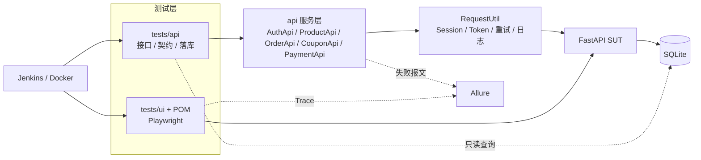

<div align="center">

# TestForge

**自包含的商品 / 订单系统自动化测试框架**

[](https://www.python.org/)
[](https://pytest.org/)
[](https://playwright.dev/)
[](https://qameta.io/allure-report/)
[](https://www.jenkins.io/)
[](https://www.docker.com/)
[](LICENSE)

pytest + requests + Playwright + Allure + Jenkins，覆盖接口、数据库落库与 Web UI 三层验证。

</div>

---

## 为什么自带被测系统

多数练习项目直接请求 jsonplaceholder / httpbin 这类公网 mock 服务，存在三个问题：

1. **无法验证业务语义**：mock 服务不会校验库存、角色权限、订单状态机，测不出真实缺陷；
2. **无法做落库断言**：只有 HTTP 响应，无法确认库存扣减、订单明细是否真正持久化；
3. **结果不可复现**：公网抖动、限流、数据变化都会让用例随机失败。

因此本项目内置一个 **FastAPI + SQLAlchemy + SQLite** 的商品/订单服务（SUT），具备 JWT 鉴权、角色权限、库存扣减、订单状态机、幂等下单与统一错误码。测试运行时由会话级 fixture 自动拉起独立实例（独立端口 + 独立数据库文件），一条命令即可离线复现全部用例。

---

## 核心特性

| 能力 | 实现 |
|:--|:--|
| 分层设计 | `tests → api 服务层 → RequestUtil → SUT`，UI 层独立 POM |
| 数据隔离 | 每个 xdist worker 启动独立 SUT 与 SQLite 文件，用例可并行 |
| 双层断言 | HTTP 状态/业务字段断言 + `db_util` 直连 SQLite 校验落库结果 |
| 鉴权覆盖 | 登录、Token 校验、过期 Token、角色越权（401/403） |
| 幂等下单 | `Idempotency-Key` 重放、冲突检测、跨用户隔离 |
| 并发正确性 | 条件 UPDATE 防超卖，5 并发请求验证「库存 3 成功 3 单」 |
| 契约校验 | 统一错误结构 `{code, message, details}`、响应字段与类型 |
| UI 自动化 | Playwright + POM，使用本机 Edge（`channel=msedge`），无需下载浏览器 |
| 可观测性 | Allure 步骤/附件、失败请求报文、Playwright Trace、失败截图 |
| 失败归因 | 规则引擎离线分类 9 类失败并给出排查动作，LLM 可选增强，失败自动附到 Allure |
| 缺陷注入 | 16 类典型业务缺陷可注入，矩阵脚本统计用例检出率，验证「测试真的能发现问题」 |
| CI/CD | Jenkins 并行流水线 + JUnit + Allure 归档，附 Dockerfile / compose |

---

## 被测系统（SUT）

启动后：接口文档 `/docs`，管理页面 `/ui/login`。

| 模块 | 接口 | 说明 |
|:--|:--|:--|
| 鉴权 | `POST /api/v1/auth/login`、`GET /auth/me`、`POST /auth/refresh` | JWT（HS256），admin / user 两种角色 |
| 商品 | `GET/POST /products`、`GET/PUT/DELETE /products/{id}`、`PATCH /products/{id}/stock` | 分页、关键字、分类、有货筛选、排序、库存变更 |
| 订单 | `POST /orders`、`GET /orders`、`GET /orders/{id}`、`POST /orders/{id}/cancel|ship|complete|refund` | 库存扣减、状态机、优惠券、越权校验、幂等 |
| 优惠券 | `GET/POST /coupons`、`POST /coupons/{code}/claim`、`GET /coupons/mine` | 固定/百分比折扣、门槛、有效期、每人限领、并发不超发 |
| 支付 | `POST /payments/callback` | HMAC-SHA256 签名、金额校验、交易号幂等、状态机 |
| 运维 | `GET /healthz` | 服务与数据库健康检查 |

演示账号：`admin / admin123`（管理员）、`user / user123`（普通用户）。种子数据为 10 件商品。

---

## 架构



---

## 快速开始

### 1. 安装依赖

```bash
pip install -r requirements.txt
```

> UI 用例默认调用本机 Edge（`channel=msedge`），无需执行 `playwright install`。

### 2. 执行用例

```bash
python run.py            # 全部 172 条（接口 + UI + 单测），自动启动/销毁 SUT
python run.py api        # 仅接口用例，4 进程并行
python run.py ui         # 仅 Playwright UI 用例
python run.py smoke      # 仅冒烟用例
python run.py eval       # 失败归因评测：准确率 / 宏 F1 / 混淆矩阵
python run.py serve      # 只启动 SUT，访问 http://127.0.0.1:8000/ui/login
```

也可以直接使用 pytest（SUT 仍由 fixture 自动管理）：

```bash
python -m pytest -m "not ui" -n 4
python -m pytest -m ui
```

### 3. 查看报告

```bash
allure serve ./allure-results
# 或生成静态报告
allure generate ./allure-results -o ./allure-report --clean
```

### 4. 失败归因

```bash
python -m pytest --junitxml=reports/junit.xml
python -m ai.cli --junit reports/junit.xml --out reports/triage.md
```

规则引擎离线可用，把失败分为环境/连接、服务端 5xx、参数校验、认证、权限、业务冲突、数据库、断言、未分类共 9 类，并给出排查动作。配置 `TF_LLM_BASE_URL`、`TF_LLM_API_KEY`、`TF_LLM_MODEL` 后追加 `--llm`，会补充一段根因分析；未配置或调用失败时自动降级，不影响测试结果。用例失败时归因结果也会自动附加到 Allure 报告。

### 5. 归因评测

```bash
python run.py eval        # 或 python tools/eval_triage.py
```

用 60 条人工标注的失败样本评测规则引擎，输出准确率、宏平均 F1、每类 precision/recall 与混淆矩阵，结果写入 `reports/triage_eval.md`。当前基线：准确率 **86.7%**（52/60），宏平均 F1 **0.844**；8 个错误全部是「未分类异常被误判为断言失败」，正是 LLM 语义归因要补的场景。脚本支持 `--min-accuracy` 回归门槛（默认 80%），低于门槛返回非 0，可接入 CI。

### 6. 缺陷注入

```bash
python run.py faults      # 或 python tools/fault_matrix.py
```

逐个启用 SUT 中的 16 类缺陷（超卖、幂等失效、金额算错、越权、过期 Token、优惠券重复使用、支付签名跳过等），对每一轮运行接口用例并统计是否检出，结果写入 `reports/fault_matrix.md`。这一步用于回答「用例全绿，是否真的能发现 bug」：缺陷注入后必须有用例失败，否则说明覆盖不足。

---

## 目录结构

```
testforge/
├── api/                      # 服务层：按业务组织请求，不做断言
│   ├── auth_api.py
│   ├── product_api.py
│   ├── order_api.py
│   ├── coupon_api.py
│   └── payment_api.py
├── common/
│   ├── request_util.py       # Session / Token 注入 / 重试 / 日志 / Allure 附件
│   ├── db_util.py            # SQLite 只读查询，用于落库断言
│   └── log_util.py
├── config/settings.py        # 环境变量驱动的配置
├── ai/                       # 失败归因与评测（规则引擎 + 可选 LLM）
│   ├── failure_triage.py     # JUnit 解析 / 分类 / Markdown 报告
│   ├── llm_client.py         # OpenAI 兼容接口，未配置时自动降级
│   ├── evaluation.py         # 标注样本评测：准确率 / 宏 F1 / 混淆矩阵
│   ├── eval_dataset.jsonl    # 60 条人工标注失败样本
│   └── cli.py                # python -m ai.cli
├── sut/                      # 被测系统（FastAPI + SQLAlchemy）
│   ├── app.py  models.py  schemas.py  security.py  seed.py
│   ├── faults.py             # 缺陷注入开关（TESTFORGE_FAULTS）
│   ├── routers/              # auth / products / orders / coupons / payments
│   └── static/index.html     # 管理页（带 data-testid）
├── tools/fault_matrix.py     # 逐个注入缺陷并统计检出率
├── tools/eval_triage.py      # 归因评测入口（可设准确率门槛）
├── tests/
│   ├── conftest.py           # 启动 SUT、登录、工厂 fixture、失败归因附件
│   ├── api/                  # 鉴权 / 商品 / 订单 / 优惠券 / 支付 / 契约 / 落库
│   ├── ui/                   # Playwright 用例 + pages（POM）
│   └── unit/                 # 归因引擎单测（不依赖 SUT）
├── legacy/                   # 早期 jsonplaceholder 练习用例（不参与 testpaths）
├── Dockerfile
├── docker-compose.yml
├── Jenkinsfile
├── pytest.ini
├── requirements.txt
└── run.py
```

---

## 用例规模

| 分层 | 数量 | 覆盖重点 |
|:--|--:|:--|
| 鉴权 | 17 | 登录成功/失败、参数校验、畸形与过期 Token、刷新、载荷 |
| 商品 | 44 | 列表分页/搜索/筛选/排序、详情、创建/更新/删除、权限、库存边界 |
| 订单 | 37 | 下单、金额、库存不足、状态机、越权、幂等重放与冲突、并发不超卖 |
| 优惠券 | 13 | 创建、领取、重复领取、领完、过期、门槛、折扣计算、取消归还 |
| 支付与退款 | 9 | 回调签名、金额校验、交易号幂等、支付状态、退款与库存/优惠券归还 |
| 契约 | 14 | 统一错误结构、响应字段类型、健康检查、注入与超长参数 |
| 落库一致性 | 8 | 订单/明细/库存三方一致、幂等记录、密码哈希、外键完整性 |
| UI（Playwright） | 10 | 登录、错误提示、列表渲染、搜索、新增、删除、退出、权限视图 |
| **合计** | **172** | 接口 142 + UI 10 + 单测 20 |

另有 20 条单测（`tests/unit`），不依赖 SUT，覆盖 9 类失败分类、JUnit 解析、Markdown 报告、评测指标与 LLM 未配置降级。

参数化用例覆盖边界值（分页越界、库存 0/刚好扣完、数量上下限、非法状态等）。

---

## 关键实现

### 用例隔离与并行

`tests/conftest.py` 的 `sut_server` 是会话级 fixture：为每个 worker 申请空闲端口、创建临时 SQLite 文件、以子进程启动 uvicorn，并轮询 `/healthz` 等待就绪；会话结束后终止进程。因此 `pytest -n 4` 时四个 worker 各自拥有完整独立环境，不会互相污染。`product_factory` / `order_factory` 负责用例结束后的数据清理（删除商品、取消订单归还库存）。

### 重试只发生在该重试的地方

`RequestUtil` 只对幂等方法（GET/PUT/PATCH/DELETE）做连接异常与 5xx 重试；POST 一旦发出可能已被服务端处理，因此不重试，避免重复下单。需要重试的创建类请求通过 `Idempotency-Key` 在服务端做幂等保证。

### 幂等与并发

- 相同用户 + 相同 Key + 相同请求体：返回首次结果并带 `X-Idempotent-Replay: true`；
- 相同 Key + 不同请求体：`409 IDEMPOTENCY_CONFLICT`；
- 不同用户相同 Key：互不影响；
- 下单扣库存使用 `UPDATE ... WHERE stock >= ?` 条件更新，rowcount 为 0 即库存不足，配合事务回滚，保证并发下不超卖。

### 报告

Allure 中按 `epic / feature / story` 组织用例；HTTP 4xx/5xx 自动附加请求与响应报文；UI 用例每次执行保存 Playwright Trace（含截图与 DOM 快照），失败时额外附加整页截图。

---

## 持续集成

`Jenkinsfile` 使用 Docker agent 并声明式并行：

| Stage | 镜像 | 内容 |
|:--|:--|:--|
| 接口测试 | `python:3.11-slim` | `compileall` + `pytest -m "not ui" -n 4` |
| UI 测试 | `mcr.microsoft.com/playwright/python` | `pytest -m ui` |
| 冒烟测试 | `python:3.11-slim` | `pytest -m smoke` |

三个 stage 并行执行，各自输出 JUnit 与 Allure 结果，`post` 阶段统一归档；`pollSCM` 触发增量回归。

容器化运行：

```bash
docker compose up --build sut     # 启动被测服务
docker compose run --rm tests     # 在容器内执行接口用例（连接 sut 服务）
```

---

## 本地实测

Windows 11 / Python 3.13 / Edge：

```
# 接口用例，4 进程并行
142 passed in 8.80s

# 全量（接口 + UI + 单测）
172 passed in 17.11s

# 归因评测
60 条样本，准确率 86.7%（52/60），宏平均 F1 0.844

# 缺陷注入矩阵
检出 16/16（100%），每轮注入触发 1–6 个用例失败
```

---

## 已知边界

- SUT 为演示用途，SQLite 单文件写入，未做分库分表与缓存；
- 缺陷注入的 16 类缺陷围绕现有需求设计，因此全部检出；限流、弱网、性能退化等场景尚未覆盖，这也是后续迭代方向；
- UI 用例默认使用本机 Edge；纯 Chromium 环境（如 CI 的 Playwright 镜像）设置 `TESTFORGE_BROWSER_CHANNEL=bundled` 即可使用镜像自带浏览器；
- `legacy/` 保留早期 jsonplaceholder 练习用例，不在 `testpaths` 内，不参与 CI。

## License

MIT
